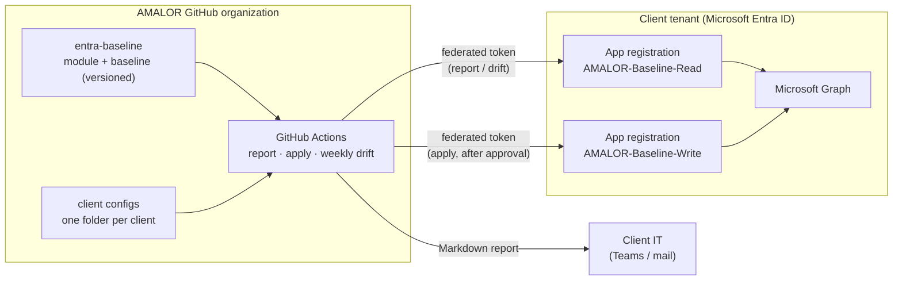

# Architecture

## Why it is built this way

| Decision | Reason |
|---|---|
| Federated credentials instead of secrets | Nothing to leak or rotate. The client's tenant only trusts tokens from one specific repository and environment. |
| Separate read and write app registrations | The weekly drift run physically cannot change anything. |
| Apply only through a protected environment | A second person must approve every change before the pipeline gets a write token. |
| Pinned module version per client | A baseline update never reaches a client by surprise; it is rolled out client by client. |
| Graph only, one dependency | Easy to audit and easy for any engineer to take over. |
| Reports kept 400 days | Evidence for audits and insurance questionnaires. |

## What runs when

| Trigger | Mode | Changes the tenant? |
|---|---|---|
| Onboarding | Report | No |
| After client approval | Apply (report-only policies) | Yes, after four-eyes approval |
| Every Monday | Report (drift) | No |
| Client approves enforcement of a policy | Apply | Yes, that policy only |

## Exit

The client deletes the two app registrations. From that moment AMALOR has no access. All policies, units and role assignments stay in the tenant and keep working.
